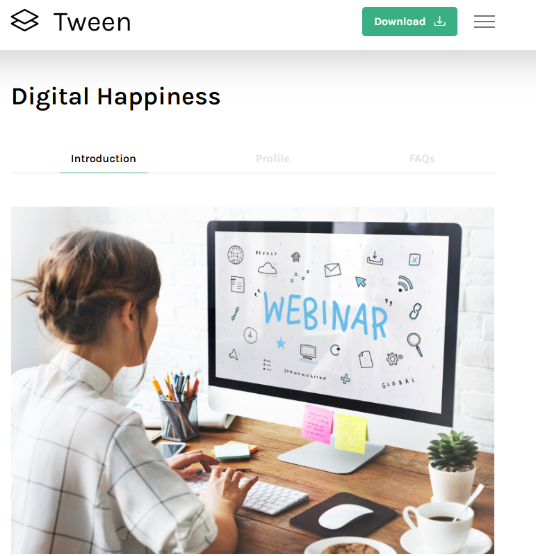

# Tween Agency Website Setup with Vagrant



This guide explains how to create a local copy of the Tween Agency website template in a Vagrant virtual machine. It starts with the manual setup and then shows how to automate it.

## How to do it manually

Vagrant creates a virtual machine (VM), which is a separate computer running inside your main computer. This lets you test the website without changing your host machine setup.

### Before you begin

Install the following tools on your computer:

- Vagrant
- A VM provider such as VirtualBox

## 1. Create and start the virtual machine

Open a terminal such as PowerShell, go to the folder where you want to keep the project, and run:

```bash
mkdir website-demo
cd website-demo
vagrant init eurolinux-vagrant/centos-stream-9
```

Open the new `Vagrantfile` in a text editor. Inside the `Vagrant.configure` block, add this line:

```ruby
config.vm.network "forwarded_port", guest: 80, host: 8080
```

This forwards port `80` inside the VM to port `8080` on your host machine, so the website will be available at `http://localhost:8080`.

If you want a fixed private IP for the VM, you can also uncomment this line:

```ruby
config.vm.network "private_network", ip: "192.168.33.12"
```

This is optional. If you use the forwarded port, you can access the site with `http://localhost:8080`.

Save the file and start the VM:

```bash
vagrant up
vagrant ssh
```

The `vagrant ssh` command opens a terminal inside the virtual machine. Run the remaining commands there.

## 2. Install and start the website software

Apache is the software that serves the website files to the browser. Install Apache and the tools needed to download and unpack the template:

```bash
sudo yum install -y httpd wget unzip vim
sudo systemctl enable --now httpd
```

The second command starts Apache and ensures it starts automatically when the VM boots.

## 3. Download and install the website template

For this example, I used the [Tween Agency template from Tooplate](https://www.tooplate.com/view/2128-tween-agency). Download and unpack it inside the VM:

```bash
cd /tmp
wget https://www.tooplate.com/zip-templates/2128_tween_agency.zip
unzip 2128_tween_agency.zip
```

Copy the template files into Apache's default website folder:

```bash
sudo cp -r 2128_tween_agency/. /var/www/html/
```

Apache uses `/var/www/html/` as its default web root.

## 4. View the website

On your computer, open a browser and go to [http://localhost:8080](http://localhost:8080). You should see the Tween Agency template.

If the page does not load, check that the VM is running with `vagrant up` and that Apache is active with:

```bash
sudo systemctl status httpd
```

## How to automate it

Instead of typing all the commands manually, you can put them into the `Vagrantfile` so they run automatically when the machine is created.

Here is a complete example:

```ruby
Vagrant.configure("2") do |config|
  config.vm.box = "eurolinux-vagrant/centos-stream-9"
  config.vm.network "forwarded_port", guest: 80, host: 8080

  config.vm.provision "shell", inline: <<-SHELL
    yum install -y httpd wget unzip vim
    systemctl enable --now httpd
    mkdir -p /tmp/agency
    cd /tmp/agency
    wget https://www.tooplate.com/zip-templates/2128_tween_agency.zip
    unzip 2128_tween_agency.zip
    cp -r 2128_tween_agency/* /var/www/html/
    systemctl restart httpd
    rm -rf /tmp/agency
  SHELL
end
```

After saving the file, start the VM with:

```bash
vagrant up
```

If everything is correct, the website should be available at [http://localhost:8080](http://localhost:8080).

A small typo or syntax error in the provision script can prevent the site from being configured correctly, so it is important to check the commands carefully before running `vagrant up`.