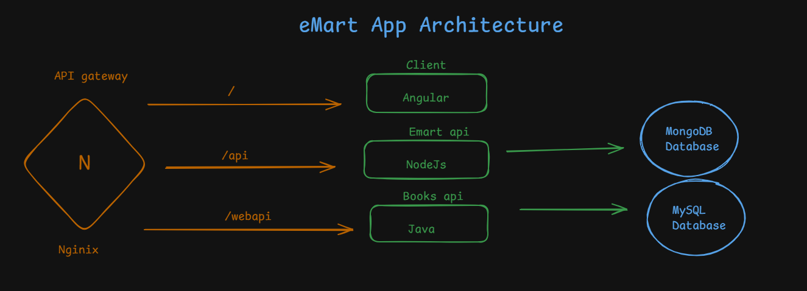

# Running the eMart App with Docker Compose

This project is a hands-on example from my DevOps learning journey. It documents how I use Docker Compose to build and run the services of the eMart application, and what I learned while troubleshooting the setup.

The application source code is maintained in the [DevOps Hyderabad eMartApp repository](https://github.com/devopshydclub/emartapp). The screenshots below show the application architecture and a page displayed after startup.



## What Docker Compose does

Docker Compose lets you define and manage an application made up of multiple containers using a Compose file, usually named `compose.yaml` or `docker-compose.yml`. In this example, Compose reads the configuration in the eMartApp repository to build the required images and start the application services together.

## Build and run the application

You need Docker with the Compose plugin installed. Clone the application repository, then run these commands from its root directory (the directory containing the Compose file):

```bash
git clone https://github.com/devopshydclub/emartapp.git
cd emartapp
docker compose build
docker compose up -d
docker compose ps
```

- `docker compose build` builds the images defined by the Compose configuration.
- `docker compose up -d` creates and starts the services in the background.
- `docker compose ps` shows the status of the services in this Compose project.

To see all containers on the Docker host, including stopped containers, run:

```bash
docker ps -a
```

Once the services are running, open the application in a browser. Use the IP address of the machine running Docker and the port configured for the web service. In my example, I used `http://192.168.56.82:80/`; your IP address and port may be different.


## Troubleshooting a Java API image build

If the Java API image fails to build, the upstream project may require a compatible Java build environment. As a learning exercise, I used the following multi-stage Dockerfile for the API, based on Eclipse Temurin Java 8. This is a troubleshooting workaround for that service, not a change to the Compose configuration, and it may need adjustment if the upstream project changes.

Edit the API's `Dockerfile` (in the `javaapi` directory) in your preferred editor and use:

```dockerfile
FROM eclipse-temurin:8u392-b08-jdk AS build
WORKDIR /app
RUN apt update && apt install maven -y
COPY . .
RUN mvn package -DskipTests

FROM eclipse-temurin:8-jdk
WORKDIR /app
COPY --from=build /app/target/*.jar app.jar
EXPOSE 9000
ENTRYPOINT ["java", "-jar", "app.jar"]
```

This Dockerfile uses one stage to build the Java application with Maven and a second stage to run the packaged JAR. `-DskipTests` skips tests during packaging, so it should not be treated as evidence that the application has passed its tests.

After saving the Dockerfile, return to the directory containing the Compose file and rebuild and restart the services:

```bash
docker compose build
docker compose up -d
docker compose ps
docker ps -a
```

This example reflects my current understanding and is intended as a record of what I have practiced. I welcome feedback and will update it as I learn more about Docker and Compose.
