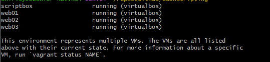

# Bash scripting: deploy a website to multiple VMs

This example shows how to use Bash loops and SSH to run commands on several
Linux virtual machines. It also demonstrates deploying the same website to
Ubuntu and CentOS servers.

## What you need

- Vagrant VMs that are running and reachable over SSH.
- A `devops` account on each VM, with SSH key authentication and permission to
  run `sudo` without an interactive password prompt.
- `remhosts`, a text file in this directory with one VM hostname per line.

For example:

```text
web01
web02
web03
```

The hostnames must resolve from the machine where you run the scripts. The
image below shows the VMs used in this example.



## Run a command on each VM

Use `while read` to read each hostname from `remhosts`. `IFS=` and `-r`
preserve the line as written and avoid interpreting backslashes.

```bash
while IFS= read -r host || [[ -n "$host" ]]; do
    [[ -z "$host" || "$host" == \#* ]] && continue
    printf 'Host: %s\n' "$host"
done < remhosts
```

To check SSH connectivity and print each VM's hostname:

```bash
while IFS= read -r host || [[ -n "$host" ]]; do
    [[ -z "$host" || "$host" == \#* ]] && continue
    ssh "devops@$host" hostname
done < remhosts
```

To install Git on CentOS VMs:

```bash
while IFS= read -r host || [[ -n "$host" ]]; do
    [[ -z "$host" || "$host" == \#* ]] && continue
    ssh "devops@$host" 'sudo yum install -y git'
done < remhosts
```

This last command uses `yum`, so run it only on CentOS VMs. Ubuntu uses
`apt-get` instead.

## Deploy a website to Ubuntu and CentOS

Save the following as `multios_websetup.sh`. It detects Ubuntu or CentOS,
installs the required packages, downloads and deploys the website template,
and starts the web server. Run it on a VM with `sudo`.

```bash
#!/usr/bin/env bash
set -euo pipefail

readonly URL='https://www.tooplate.com/zip-templates/2098_health.zip'
readonly ART_NAME='2098_health'
readonly WEB_ROOT='/var/www/html'

if [[ $EUID -ne 0 ]]; then
    echo "Run this script with sudo." >&2
    exit 1
fi

if [[ ! -r /etc/os-release ]]; then
    echo "Cannot identify this Linux distribution." >&2
    exit 1
fi

source /etc/os-release

case "$ID" in
    centos)
        PACKAGE_MANAGER='yum'
        SERVICE='httpd'
        PACKAGES=(httpd wget unzip)
        ;;
    ubuntu)
        PACKAGE_MANAGER='apt-get'
        SERVICE='apache2'
        PACKAGES=(apache2 wget unzip)
        ;;
    *)
        echo "This script supports Ubuntu and CentOS; found: $ID" >&2
        exit 1
        ;;
esac

echo "Installing packages for $PRETTY_NAME..."
if [[ "$PACKAGE_MANAGER" == 'apt-get' ]]; then
    apt-get update
fi
"$PACKAGE_MANAGER" install -y "${PACKAGES[@]}"

WORKDIR=$(mktemp -d)
trap 'rm -rf "$WORKDIR"' EXIT

echo "Downloading and extracting the website..."
wget -q "$URL" -O "$WORKDIR/$ART_NAME.zip"
unzip -q "$WORKDIR/$ART_NAME.zip" -d "$WORKDIR"

if [[ ! -d "$WORKDIR/$ART_NAME" ]]; then
    echo "Expected website directory was not found in the downloaded archive." >&2
    exit 1
fi

mkdir -p "$WEB_ROOT"
cp -a "$WORKDIR/$ART_NAME/." "$WEB_ROOT/"

systemctl enable --now "$SERVICE"
systemctl restart "$SERVICE"
systemctl --no-pager --full status "$SERVICE"

echo "Website files are deployed to $WEB_ROOT."
```

## Deploy to every VM

Save this as `deploy_to_hosts.sh` in the same directory as
`multios_websetup.sh` and `remhosts`. It copies the setup script to each VM,
runs it with `sudo`, and removes the temporary remote copy after a successful
deployment.

```bash
#!/usr/bin/env bash
set -euo pipefail

readonly USR='devops'
readonly SCRIPT='multios_websetup.sh'

while IFS= read -r host || [[ -n "$host" ]]; do
    [[ -z "$host" || "$host" == \#* ]] && continue

    echo "Deploying to $host..."
    scp "$SCRIPT" "$USR@$host:/tmp/$SCRIPT"
    ssh "$USR@$host" "sudo -n bash /tmp/$SCRIPT && sudo -n rm -f /tmp/$SCRIPT"
done < remhosts

echo "Deployment completed on all listed VMs."
```

Make both scripts executable, then run the deployment script:

```bash
chmod +x multios_websetup.sh deploy_to_hosts.sh
./deploy_to_hosts.sh
```

The deployment stops if a copy or remote command fails. `sudo -n` makes the
remote command fail rather than wait for a password, so configure the `devops`
account's `sudo` permissions before running this example.
