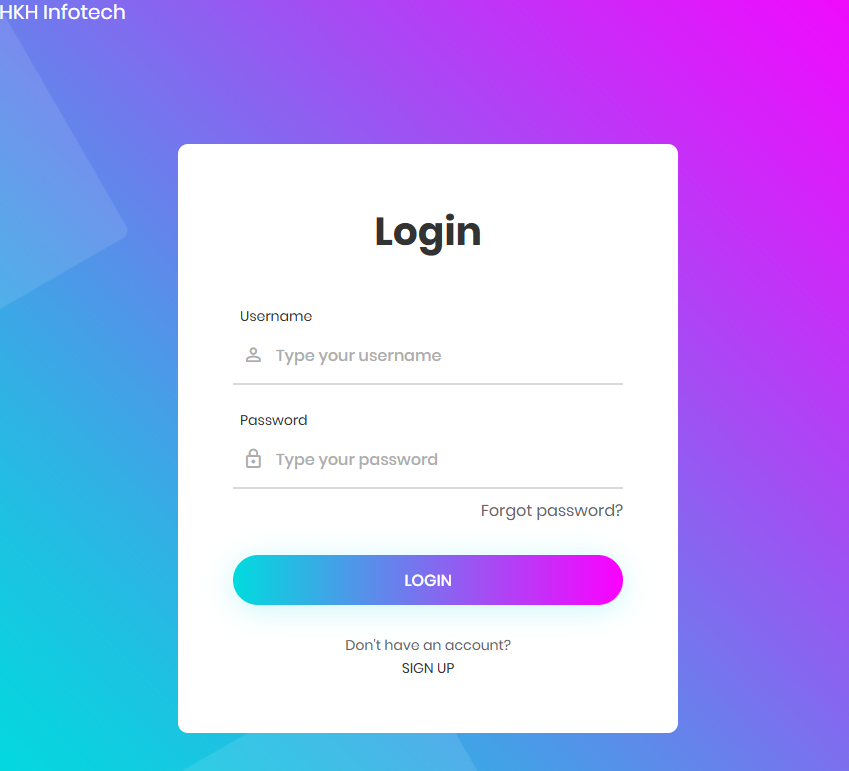

# VProfile Automated Setup

This directory contains the automated VProfile lab. Vagrant creates five virtual machines, and shell provisioning scripts install and configure the services on them.

For an overview of both deployment approaches, see the [VProfile README](../README.md). The [manual setup guide](../Manually/README.md) covers the same service roles with step-by-step installation instructions. Choose one environment at a time: the automated and manual Vagrantfiles use overlapping hostnames and private IP addresses.

> **Lab environment:** Review the provisioning scripts before running them. They use example credentials, change service and firewall settings, and rely on package repositories and software versions that may need updating. Use this setup only on an isolated local network.

## Architecture

The automated Vagrantfile defines these virtual machines:

| Host | Role | Operating system | Private IP | Memory | Provisioning script |
| --- | --- | --- | --- | --- | --- |
| `web01` | Nginx reverse proxy | Ubuntu Jammy 64-bit | `192.168.56.11` | 800 MB | [`nginx.sh`](nginx.sh) |
| `app01` | Java application server | CentOS Stream 9 | `192.168.56.12` | 800 MB | [`tomcat.sh`](tomcat.sh) |
| `rmq01` | RabbitMQ message broker | CentOS Stream 9 | `192.168.56.16` | 600 MB | [`rabbitmq.sh`](rabbitmq.sh) |
| `mc01` | Memcached service | CentOS Stream 9 | `192.168.56.14` | 600 MB | [`memcache.sh`](memcache.sh) |
| `db01` | MariaDB database | CentOS Stream 9 | `192.168.56.15` | 600 MB | [`mysql.sh`](mysql.sh) |

The request path is:

```text
Browser → web01 (Nginx) → app01 (Tomcat, port 8080)
                               ├── db01 (MariaDB)
                               ├── mc01 (Memcached)
                               └── rmq01 (RabbitMQ)
```

The Vagrantfile uses the Vagrant Host Manager plugin to map the VM hostnames for communication on the private network. Note that `rmq01` uses `192.168.56.16` here; the manual Vagrantfile assigns it a different address.

## Prerequisites

- Oracle VirtualBox
- Vagrant
- Git
- A terminal that can run Vagrant and the provisioning scripts (Git Bash on Windows is suitable)
- Enough host memory and disk space to run five virtual machines
- Support for the Vagrant private network range `192.168.56.x`

Install the Host Manager plugin before starting the environment:

```bash
vagrant plugin install vagrant-hostmanager
```

## Start the automated environment

From the repository root, run:

```bash
cd VProfile/Automated
vagrant up
```

Vagrant provisions the machines using the scripts referenced in the [Vagrantfile](Vagrantfile). The first startup may take several minutes while Vagrant downloads the base boxes and installs packages. If provisioning fails, inspect the output and the relevant script before retrying.

Check the state of the machines from `VProfile/Automated`:

```bash
vagrant status
```

## Access the application and virtual machines

When provisioning is complete and the services are running, open the application at:

<http://192.168.56.11>

This is the private IP assigned to `web01`, where Nginx forwards requests to Tomcat on `app01`.



Connect to a VM by its hostname from the `VProfile/Automated` directory. For example:

```bash
vagrant ssh app01
```

Other VM hostnames are `web01`, `db01`, `mc01`, and `rmq01`.

## Common Vagrant commands

Run these commands from `VProfile/Automated`:

```bash
vagrant status
vagrant halt
vagrant up
```

To delete the VMs created by this Vagrantfile and their local data:

```bash
vagrant destroy
```

Use `vagrant destroy` only when you intend to remove the environment. It does not affect the separate environment defined in `Manually/`.

## Provisioning scripts

The Vagrantfile invokes these scripts:

- [`mysql.sh`](mysql.sh) installs MariaDB, creates the application database, and restores the database dump.
- [`memcache.sh`](memcache.sh) installs and configures Memcached.
- [`rabbitmq.sh`](rabbitmq.sh) installs and configures RabbitMQ.
- [`tomcat.sh`](tomcat.sh) installs Java, Tomcat, and Maven, builds the application, and deploys it to Tomcat.
- [`nginx.sh`](nginx.sh) installs Nginx and configures it as a reverse proxy to `app01`.

[`tomcat_ubuntu.sh`](tomcat_ubuntu.sh) and [`backend.sh`](backend.sh) are also present in this directory, but the current Vagrantfile does not reference them; `vagrant up` does not run them.

The database script clones the application repository's `main` branch to load its database dump, while the Tomcat script builds the `local` branch. Confirm that these branches contain compatible application and database versions before provisioning.

## Configuration and security notes

- The scripts and [`application.properties`](application.properties) contain example settings, including credentials. Replace them for your own isolated lab, and never commit real passwords or reuse demo credentials.
- Some services are configured to accept connections from other VMs on the private network. Do not expose this lab to an untrusted or public network.
- The application properties refer to an Elasticsearch host, but this Vagrantfile does not create an Elasticsearch VM. Configure an accessible Elasticsearch service if the application requires it.
- The provisioning scripts pin or use older package sources and software versions. Review compatibility and update them as needed before running the lab.

## Related documentation

For manual installation and service-specific instructions, see the [manual setup guide](../Manually/README.md):

- [MySQL/MariaDB setup](../Manually/README.MSQLSetup.md)
- [Memcached setup](../Manually/README.MemcacheSetUp.md)
- [RabbitMQ setup](../Manually/README.RabbitMQ.md)
- [Tomcat setup](../Manually/README.Tomcat.md)
- [Nginx setup](../Manually/README.NginixSetup.md)
- [Build and deploy](../Manually/README.Building%26Deploy.md)
