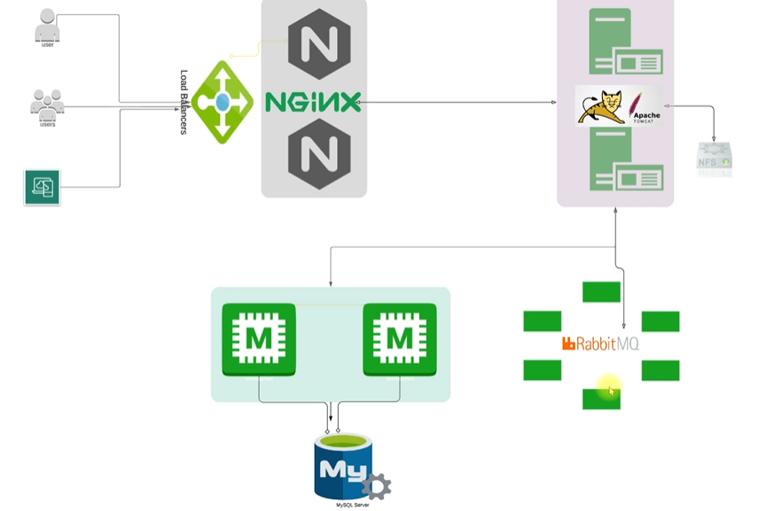
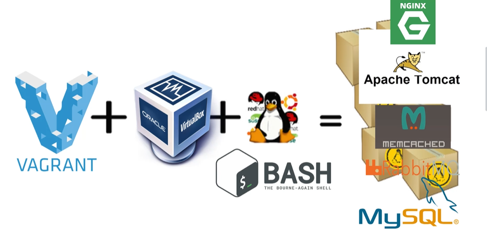

# VProfile Manual Setup Guide

This guide introduces the manual VProfile deployment in this directory. It describes the local lab, its virtual machines, and how to continue with the detailed setup guides for each service.

## Objectives

- Automate local virtual machine setup with Vagrant.
- Create a baseline environment for future projects.
- Practice setting up a real-world application stack locally.

## Prerequisites

- Oracle VirtualBox
- Vagrant
- Git Bash
- Sublime Text

## Architecture

The VProfile environment uses these services:

| Service | Purpose |
| --- | --- |
| Nginx | Accepts web requests and forwards them to the application server. |
| Apache Tomcat | Runs the Java web application. |
| RabbitMQ | Provides message-broker functionality. |
| Memcached | Provides caching for the application. |
| MySQL | Stores application data. |

Apache Tomcat is a Java application server used to run the web application.





## Detailed setup guides

Use the guides below to install and configure each component:

1. [Create and manage the virtual machines](#start-the-virtual-machines)
2. [Set up MySQL](README.MSQLSetup.md)
3. [Set up Memcached](README.MemcacheSetUp.md)
4. [Set up RabbitMQ](README.RabbitMQ.md)
5. [Install Tomcat](README.Tomcat.md)
6. [Set up Nginx](README.NginixSetup.md)
7. [Build and deploy the application](README.Building%26Deploy.md)

## Start the virtual machines

The [`Vagrantfile`](Vagrantfile) defines five virtual machines, one for each role in the environment. Before starting them, install the Vagrant Host Manager plugin. It helps map each virtual machine's IP address to its hostname.

```bash
vagrant plugin install vagrant-hostmanager
```

After starting the virtual machines, check the host mappings. Run this command as a user with permission to read `/etc/hosts`:

```bash
cat /etc/hosts
#Output
192.168.56.12   app01

192.168.56.15   db01

192.168.56.14   mc01

192.168.56.13   rmq01

192.168.56.11   web01

```

Use a virtual machine's hostname to connect to it. For example:

```bash
Vagrant ssh app01
```

## Open the application

After the services are installed and running, open the web application at `http://192.168.56.11:80`:


## Troubleshooting

If the site is unavailable or Nginx displays a `502 Bad Gateway` error after setup, check the firewall settings on `app01` and `db01`. The following command is the original troubleshooting step documented for this lab:

```bash
# VM app01 and db01
Sytemctl stop firewalld 
```

Note: Use this step only in an isolated lab environment. For other environments, configure the required firewall rules instead of stopping the firewall.
