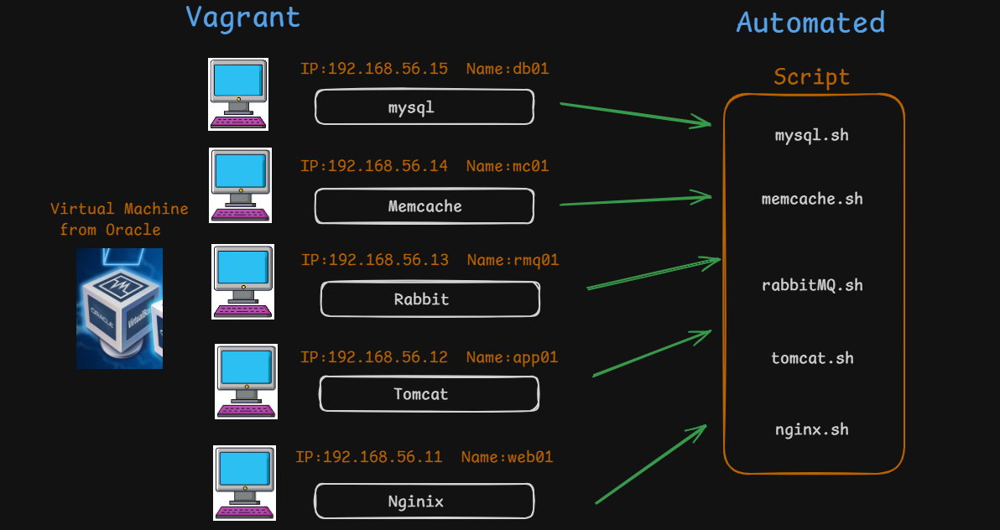
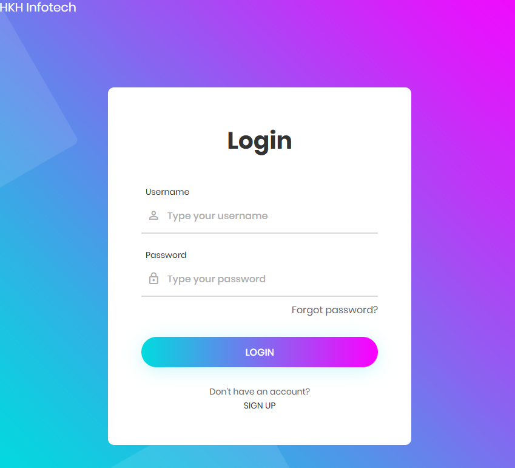

# VProfile: Multi-VM Deployment Lab

VProfile is a local lab for deploying a Java web application with a distributed service stack. It uses Vagrant and VirtualBox to create virtual machines for the web proxy, application server, database, cache, and message broker.

This directory contains two deployment approaches:

- **Automated** — Vagrant provisions the virtual machines and runs shell provisioning scripts.
- **Manual** — Vagrant creates the virtual machines; you install and configure the services by following the guides in [`Manually/`](Manually/).

## Architecture

| Host | Role | Service |
| --- | --- | --- |
| `web01` | Web entry point | Nginx reverse proxy |
| `app01` | Java application | Apache Tomcat |
| `db01` | Persistent storage | MySQL-compatible database |
| `mc01` | Cache | Memcached |
| `rmq01` | Messaging | RabbitMQ |

The web server forwards HTTP requests to the application server. The application server connects to the database, cache, and message broker over the Vagrant private network.

## Prerequisites

- Oracle VirtualBox
- Vagrant
- The Vagrant Host Manager plugin
- Git and a terminal (Git Bash on Windows is suitable)
- Enough host memory and disk space to run five virtual machines

Install the Host Manager plugin before starting either environment:

```bash
vagrant plugin install vagrant-hostmanager
```

## Choose a deployment approach

### Automated provisioning

The `Automated/` directory contains a Vagrantfile and shell scripts for provisioning the services. Review the scripts before running them; package repositories and pinned software versions may need updates for your host and guest operating systems.

```bash
cd VProfile/Automated
vagrant up
```

### Manual provisioning

The `Manually/` directory contains a separate Vagrantfile and step-by-step service guides. Start its virtual machines, then follow the guides to install and configure each component:

```bash
cd VProfile/Manually
vagrant up
```

Guides are available for [MariaDB setup](Manually/README.MSQLSetup.md), [Memcached setup](Manually/README.MemcacheSetUp.md), [RabbitMQ setup](Manually/README.RabbitMQ.md), [Tomcat setup](Manually/README.Tomcat.md), [Nginx setup](Manually/README.NginixSetup.md), and [building and deploying the application](Manually/README.Building%26Deploy.md). The [manual setup overview](Manually/README.md) provides additional context.


## Access the application

When the web VM and application are running, open:

<http://192.168.56.11:80>

This address is assigned to `web01` in the Vagrantfiles. If it is not reachable, check the VM status, the Nginx and Tomcat services, and the private-network configuration.

Note: The username created by dummy  mysql, has this credential as username and password: admin_vp



## Common Vagrant commands

Run these commands from the directory containing the Vagrantfile you want to manage (`Automated/` or `Manually/`):

```bash
vagrant status
vagrant ssh web01
vagrant halt
```

To remove that environment's virtual machines and their local data:

```bash
vagrant destroy
```

## Security

This project is intended for local learning. Treat any example credentials in the application configuration or provisioning scripts as insecure: replace them for your lab, keep real secrets out of source control, and do not expose these services to an untrusted network.
